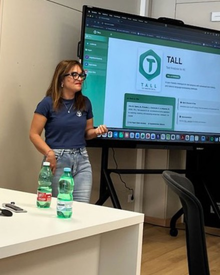
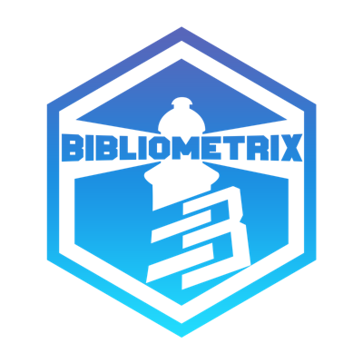
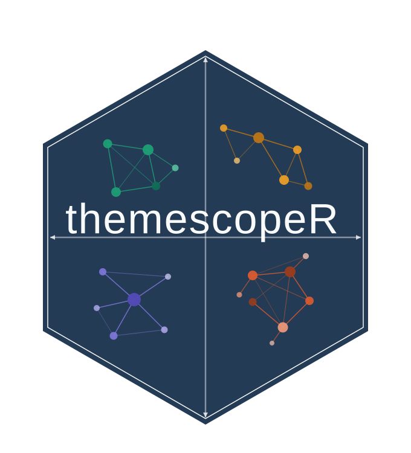
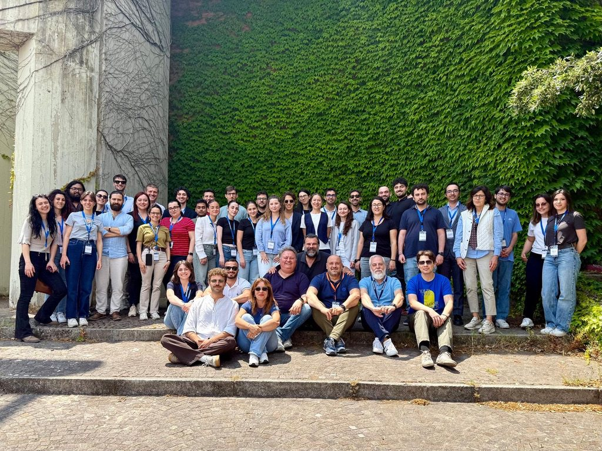
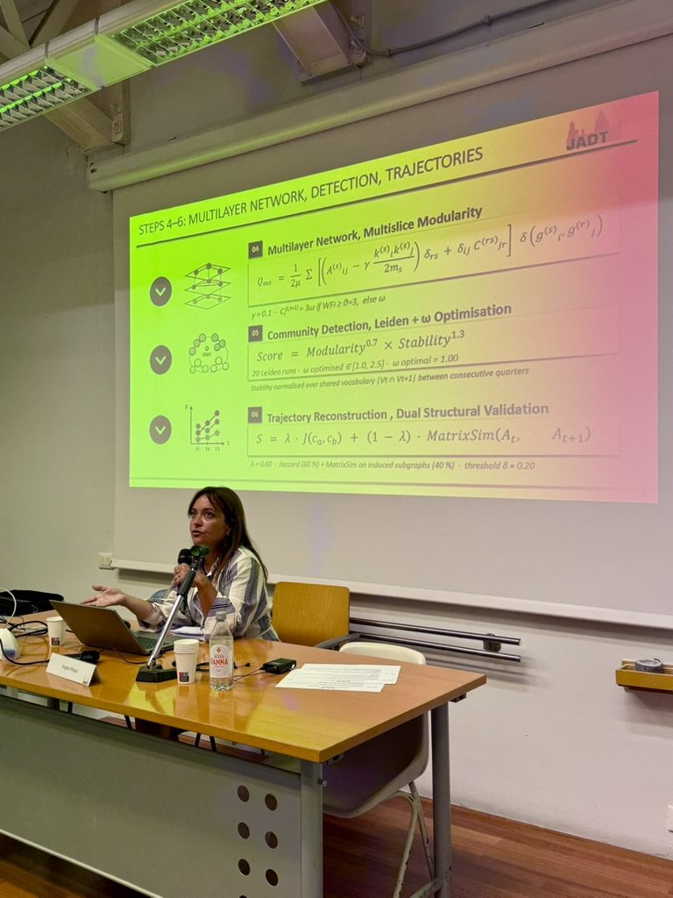
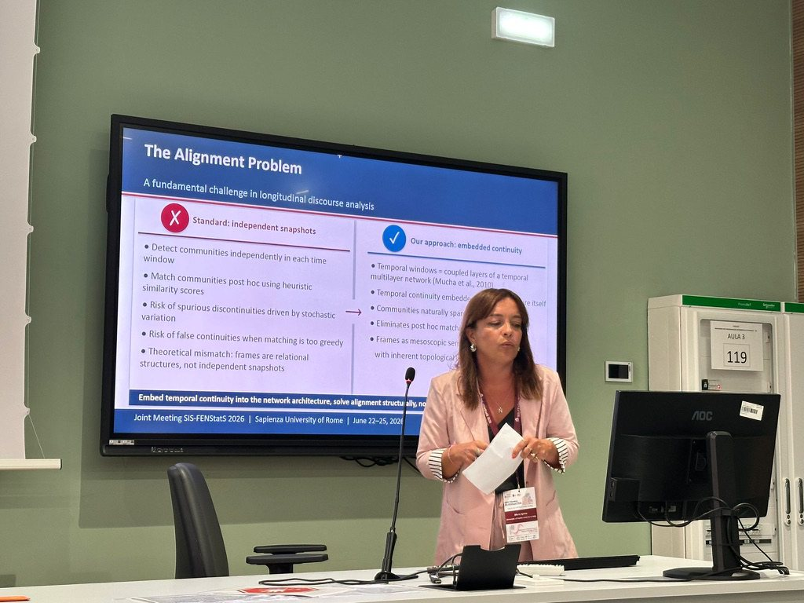
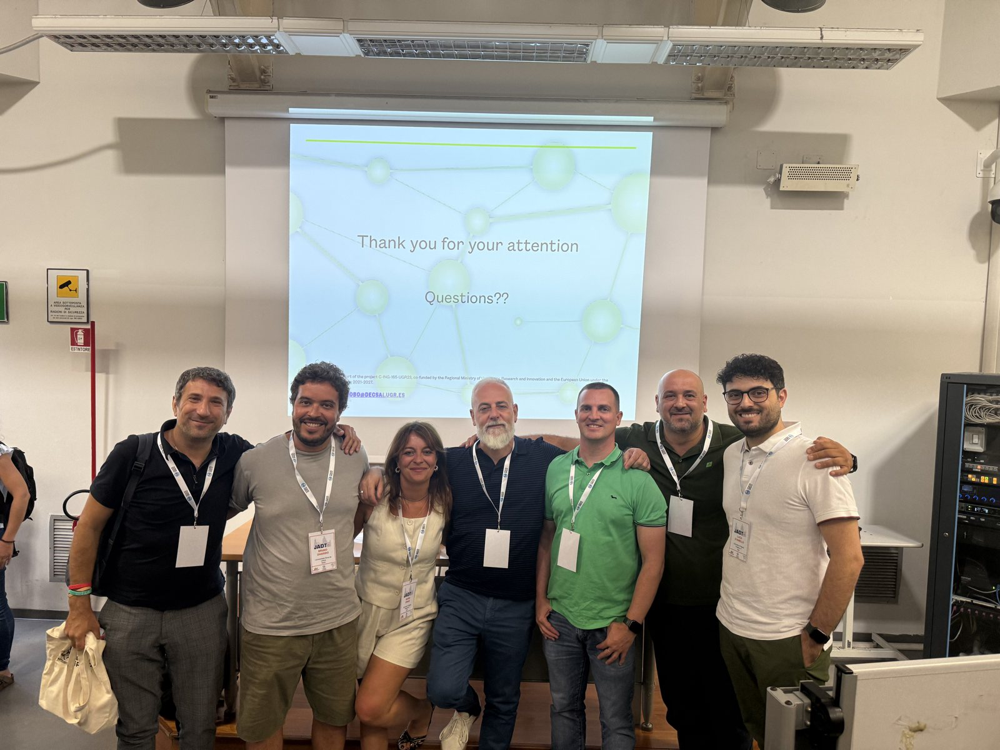
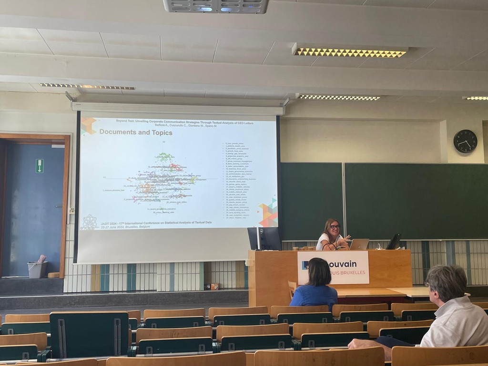

```{=html}
<!-- ============================ HERO ============================ -->
<section class="ms-hero">
  <span class="blob blob-1"></span>
  <span class="blob blob-2"></span>
  <span class="blob blob-3"></span>
  <div class="ms-wrap ms-hero-grid">
    <div class="ms-hero-text">
      <span class="ms-hero-label"><span class="dot"></span>University of Naples Federico II · DiSES</span>
      <h1 class="ms-hero-name">Maria<br><span class="hl">Spano</span></h1>
      <p class="ms-hero-role">
        <strong>Tenure-Track Assistant Professor (RTDB)</strong> in Statistics for Social Science.
        National Scientific Qualification as Associate Professor. I turn texts, opinions and scientific literature into data and knowledge.
      </p>
      <div class="ms-tags">
        <span class="ms-tag">Text Mining</span>
        <span class="ms-tag">Sentiment Analysis</span>
        <span class="ms-tag">Science Mapping</span>
        <span class="ms-tag">Bibliometrics</span>
        <span class="ms-tag">Data Mining</span>
        <span class="ms-tag">Document Clustering</span>
      </div>
      <div class="ms-cta">
        <a href="publications.html" class="ms-btn ms-btn-primary"><i class="bi bi-journal-text"></i> Research &amp; Publications</a>
        <a href="projects.html" class="ms-btn ms-btn-ghost"><i class="bi bi-boxes"></i> Software &amp; Projects</a>
      </div>
    </div>
    <div class="ms-hero-photo">
      
    </div>
  </div>
</section>

```



```{=html}
<!-- ============================ ABOUT ============================ -->
<section class="ms-section">
  <div class="ms-wrap ms-bio-grid">
    <div class="ms-bio-text reveal">
      <span class="ms-eyebrow">About</span>
      <h2>Hi, I'm Maria</h2>
      <p>I am a <strong>Tenure-Track Assistant Professor (RTDB)</strong> in <em>Social Statistics</em> (STAT-03/B) at the <strong>University of Naples Federico II</strong>, Department of Economics and Statistics, where I also earned my <strong>Ph.D. in Statistics</strong>. I hold the <strong>National Scientific Qualification as Associate Professor</strong> (13/D3, valid until 2034).</p>
      <p>My research focuses on <strong>quantitative methods for text and data analysis</strong>, with an emphasis on computational approaches to social science and bibliometrics. Since 2017 I have been part of the development team of <a href="https://www.bibliometrix.org" target="_blank">bibliometrix</a>; I co-develop <a href="https://massimoaria.github.io/tall/" target="_blank">TALL</a> and <a href="https://github.com/lucadaniello/themescopeR" target="_blank">themescopeR</a>, and I am a member of the academic spin-off <a href="https://www.bibliometrix.org/k-synth-lab/" target="_blank">K-Synth</a> and of the <strong>VRD Lab</strong> for research and teaching evaluation.</p>
      <p>Since 2024 I have been a permanent member of the <strong>Scientific Committee of JADT</strong> (International Conference on Statistical Analysis of Textual Data). I chaired the organising committee of JADT 2022 in Naples and served on the organising committee of CLADAG 2025. I took part in the PRIN 2022 projects <strong>SciK-Health</strong> and <strong>The value of scientific production for patient care in Academic Health Science Centres</strong>, and I am a member of the Andalusian FEDER project <strong>C-ING-165-UGR23</strong> with the University of Granada. At DiSES I sit on the <strong>Visiting Committee</strong> (since 2021) and the <strong>Communication and Social Media Committee</strong> (since 2026).</p>
    </div>
    <div class="ms-edu reveal">
      <h3><i class="bi bi-briefcase-fill" style="color: var(--coral)"></i> Career</h3>
      <div class="ms-edu-item">
        <span class="ms-edu-year">2024 – today</span>
        <span class="ms-edu-title">Tenure-Track Assistant Professor (RTDB)</span>
        <span class="ms-edu-note">Dept. of Economics and Statistics, University of Naples Federico II</span>
      </div>
      <div class="ms-edu-item">
        <span class="ms-edu-year">2023</span>
        <span class="ms-edu-title">National Scientific Qualification</span>
        <span class="ms-edu-note">Associate Professor, 13/D3 (valid until 2034)</span>
      </div>
      <div class="ms-edu-item">
        <span class="ms-edu-year">2020 – 2024</span>
        <span class="ms-edu-title">Assistant Professor (RTDA)</span>
        <span class="ms-edu-note">Dept. of Economics and Statistics, University of Naples Federico II</span>
      </div>
      <div class="ms-edu-item">
        <span class="ms-edu-year">2015 – 2020</span>
        <span class="ms-edu-title">Postdoctoral Research Fellow</span>
        <span class="ms-edu-note">Joint analysis of numerical and textual web data, Open Data and Web Mining</span>
      </div>
      <h3 style="margin-top:1.6rem"><i class="bi bi-mortarboard-fill" style="color: var(--violet)"></i> Education</h3>
      <div class="ms-edu-item">
        <span class="ms-edu-year">2015</span>
        <span class="ms-edu-title">Ph.D. in Statistics</span>
        <span class="ms-edu-note">University of Naples Federico II (XXVII cycle). Thesis: <em>Validation techniques for document clustering</em>. Supervisor: Prof. Simona Balbi.</span>
      </div>
      <div class="ms-edu-item">
        <span class="ms-edu-year">2010</span>
        <span class="ms-edu-title">Degree in Statistics for Decision-Making and Complex Systems Analysis, 110/110 cum laude</span>
        <span class="ms-edu-note">University of Naples Federico II. Thesis: <em>Information Retrieval techniques for document indexing</em>.</span>
      </div>
    </div>
  </div>
</section>

<!-- ============================ RESEARCH INTERESTS ============================ -->
<section class="ms-section">
  <div class="ms-wrap">
    <span class="ms-eyebrow">Research interests</span>
    <h2>What I work on</h2>
    <div class="ms-cards">
      <div class="ms-card c-coral reveal">
        <div class="ic"><i class="bi bi-file-text-fill"></i></div>
        <h3>Text Mining</h3>
        <p>Statistical analysis of textual data, topic and theme extraction, text summarisation and framing detection.</p>
      </div>
      <div class="ms-card c-teal reveal">
        <div class="ic"><i class="bi bi-chat-heart-fill"></i></div>
        <h3>Sentiment Analysis</h3>
        <p>Opinion mining on social media, online reviews and student feedback, including geo-referenced sentiment.</p>
      </div>
      <div class="ms-card c-violet reveal">
        <div class="ic"><i class="bi bi-diagram-3-fill"></i></div>
        <h3>Science Mapping</h3>
        <p>Bibliometrics, conceptual and thematic evolution of research fields, evaluation of scientific production.</p>
      </div>
      <div class="ms-card c-sun reveal">
        <div class="ic"><i class="bi bi-grid-3x3-gap-fill"></i></div>
        <h3>Document Clustering</h3>
        <p>Data mining, clustering validation and network-based dimensionality reduction for large document collections.</p>
      </div>
    </div>
  </div>
</section>

<!-- ============================ SOFTWARE BAND ============================ -->
<section class="ms-band">
  <div class="ms-wrap">
    <span class="ms-eyebrow">Open science</span>
    <h2>Software &amp; initiatives</h2>
    <p class="ms-lead">Open-source tools and training that bring text analysis and science mapping to everyone.</p>
    <div class="ms-feature-grid">
      <a class="ms-feature c-violet reveal" href="https://www.bibliometrix.org" target="_blank">
        <div class="ms-feature-logo"></div>
        <div class="ms-feature-body">
          <span class="k">R package</span>
          <h3>bibliometrix</h3>
          <p>R package and Biblioshiny app for science mapping and bibliometric analysis.</p>
        </div>
      </a>
      <a class="ms-feature c-teal reveal" href="https://massimoaria.github.io/tall/" target="_blank">
        <div class="ms-feature-logo"></div>
        <div class="ms-feature-body">
          <span class="k">R / Shiny app</span>
          <h3>TALL</h3>
          <p>Text Analysis for All: explore, model and visualise textual data without coding.</p>
        </div>
      </a>
      <a class="ms-feature c-sky reveal" href="https://github.com/lucadaniello/themescopeR" target="_blank">
        <div class="ms-feature-logo"></div>
        <div class="ms-feature-body">
          <span class="k">R package</span>
          <h3>themescopeR</h3>
          <p>Social representation analysis via semantic network mapping.</p>
        </div>
      </a>
      <a class="ms-feature c-coral reveal" href="https://www.bibliometrix.org/sssm" target="_blank">
        
        <div class="ms-feature-body">
          <span class="k">Training</span>
          <h3>Summer School in Science Mapping</h3>
          <p>Coordinator and lecturer of the Naples summer school. The V edition runs 24–28 May 2027.</p>
        </div>
      </a>
    </div>
  </div>
</section>

<!-- ============================ NEWS ============================ -->
<section class="ms-section">
  <div class="ms-wrap">
    <span class="ms-eyebrow">Latest</span>
    <h2>News</h2>
    <div class="ms-news">
      <div class="ms-news-item c-coral reveal">
        <div class="ms-news-date">2026<b>JOI</b></div>
        <p><em>Rethinking thematic evolution in science mapping</em>, a framework for longitudinal analysis, published in <strong>Journal of Informetrics</strong>.</p>
      </div>
      <div class="ms-news-item c-teal reveal">
        <div class="ms-news-date">2026<b>ERSS</b></div>
        <p><em>Energy transition as the core of climate discourse</em> published in <strong>Energy Research &amp; Social Science</strong>.</p>
      </div>
      <div class="ms-news-item c-violet reveal">
        <div class="ms-news-date">2026<b>CRAN</b></div>
        <p>New R package <strong>themescopeR</strong> for social representation analysis via semantic network mapping.</p>
      </div>
      <div class="ms-news-item c-sky reveal">
        <div class="ms-news-date">2026<b>SCIM</b></div>
        <p><em>A multi-phase reference matching algorithm for bibliometric analysis</em> published in <strong>Scientometrics</strong>.</p>
      </div>
      <div class="ms-news-item c-sun reveal">
        <div class="ms-news-date">Jul<b>2026</b></div>
        <p>Two papers on climate discourse and AI news frames presented at <strong>JADT 2026</strong> in Palermo, and one at <strong>SIS-FENStatS 2026</strong> in Rome.</p>
      </div>
      <div class="ms-news-item c-pink reveal">
        <div class="ms-news-date">May<b>2027</b></div>
        <p><strong>Coming up:</strong> V edition of the <a href="https://www.bibliometrix.org/sssm" target="_blank">Summer School in Science Mapping</a>, Naples, 24–28 May 2027.</p>
      </div>
    </div>
  </div>
</section>

<!-- ============================ MOMENTS ============================ -->
<section class="ms-section">
  <div class="ms-wrap">
    <span class="ms-eyebrow">On the road</span>
    <h2>Conferences, classes &amp; people</h2>
    <div class="ms-mosaic">
      <a href="images/2026/jadt26-talk1.jpg" data-lightbox="home" data-title="JADT 2026, Palermo"><span>JADT 2026 · Palermo</span></a>
      <a href="images/2026/sis26-talk.jpg" data-lightbox="home" data-title="SIS-FENStatS 2026, Rome"><span>SIS 2026 · Rome</span></a>
      <a href="images/2026/ss26-group.jpg" data-lightbox="home" data-title="Summer School in Science Mapping 2026"><span>Summer School 2026</span></a>
      <a href="images/2026/jadt26-group.jpg" data-lightbox="home" data-title="JADT 2026, Palermo"><span>JADT 2026</span></a>
      <a href="publications.html#from-the-conferences"><span>More photos →</span></a>
    </div>
  </div>
</section>

<!-- ============================ CTA ============================ -->
<div class="ms-wrap">
  <div class="ms-cta-strip">
    <div>
      <h2>Let's collaborate</h2>
      <p>Research projects, seminars, workshops on text analysis and science mapping.</p>
    </div>
    <a href="contacts.html" class="ms-btn ms-btn-white"><i class="bi bi-envelope-fill"></i> Get in touch</a>
  </div>
</div>
```
