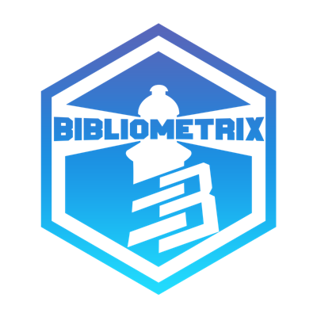
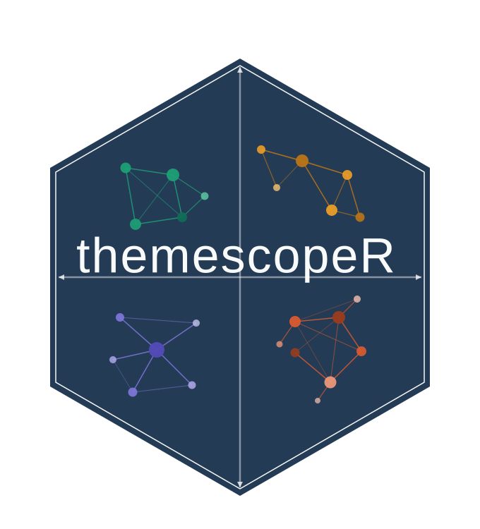
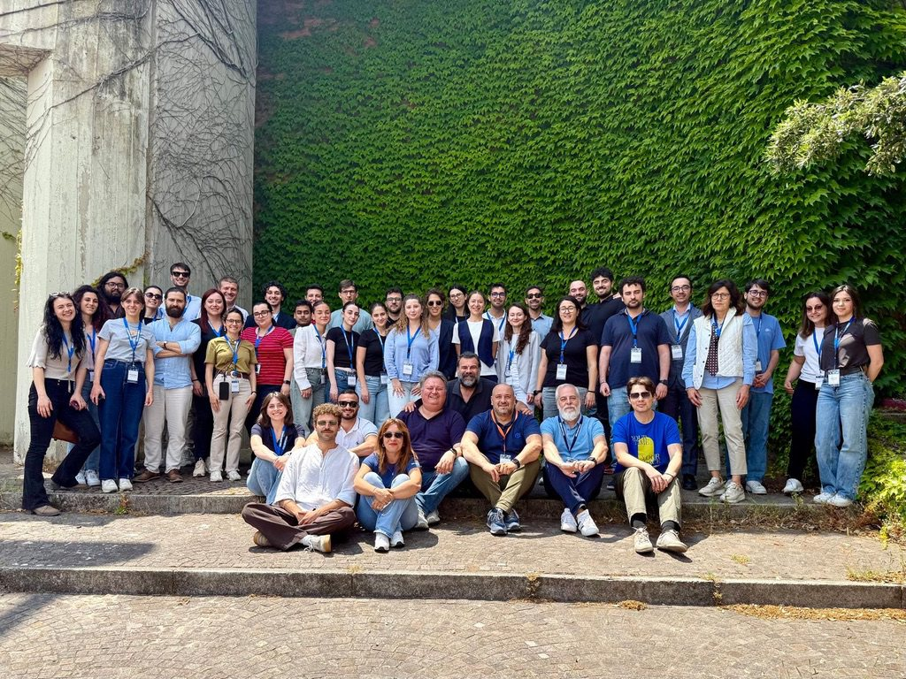

```{=html}
<h2>Software</h2>
<div class="pj-grid">

  <div class="pj-card c-violet reveal">
    <div class="pj-head">
      <div class="ic logo"></div>
      <div><span class="k">R package · Shiny app</span><h3>bibliometrix &amp; Biblioshiny</h3></div>
    </div>
    <div class="pj-body">
      <p>Open-source R package for quantitative research in scientometrics and bibliometrics, with the Biblioshiny web interface. I am part of the development team. The SAAS workflow for transparent and reproducible science mapping with Biblioshiny is described in <em>Journal of Informetrics</em> (2026).</p>
      <div class="pj-links">
        <a href="https://www.bibliometrix.org" target="_blank">Website</a>
        <a href="https://cran.r-project.org/package=bibliometrix" target="_blank">CRAN</a>
      </div>
    </div>
  </div>

  <div class="pj-card c-teal reveal">
    <div class="pj-head">
      <div class="ic logo"></div>
      <div><span class="k">R · Shiny app</span><h3>TALL · Text Analysis for All</h3></div>
    </div>
    <div class="pj-body">
      <p>An interactive R-Shiny application for exploring, modelling and visualising textual data, designed for researchers without programming skills. Published in <em>SoftwareX</em> (2026).</p>
      <div class="pj-links">
        <a href="https://massimoaria.github.io/tall/" target="_blank">Website</a>
        <a href="https://cran.r-project.org/package=tall" target="_blank">CRAN</a>
      </div>
    </div>
  </div>

  <div class="pj-card c-pink reveal">
    <div class="pj-head">
      <div class="ic logo"></div>
      <div><span class="k">R package · 2026</span><h3>themescopeR</h3></div>
    </div>
    <div class="pj-body">
      <p>Social representation analysis via semantic network mapping. It implements the ThemeScope approach to quantitative thematic analysis of digital arenas (<em>Journal of Information Science</em>, 2026).</p>
      <div class="pj-links">
        <a href="https://github.com/lucadaniello/themescopeR" target="_blank">GitHub</a>
        <a href="https://cran.r-project.org/package=themescopeR" target="_blank">CRAN</a>
      </div>
    </div>
  </div>

</div>

<h2>Research projects</h2>
<div class="pj-grid">

  <div class="pj-card c-coral reveal">
    <div class="pj-head">
      <div class="ic"><i class="bi bi-hospital-fill"></i></div>
      <div><span class="k">PRIN 2022 · 2023–2026</span><h3>SciK-Health</h3></div>
    </div>
    <div class="pj-body">
      <p><em>Mapping Scientific Knowledge about health for decision-making</em> (2022825Y5E). Outputs include the SciK-Health open-data dashboard for the multidimensional evaluation of Italian academic health science centers (<em>Quality &amp; Quantity</em>, 2026).</p>
      <div class="pj-links"><a href="publications.html">Related publications</a></div>
    </div>
  </div>

  <div class="pj-card c-teal reveal">
    <div class="pj-head">
      <div class="ic"><i class="bi bi-heart-pulse-fill"></i></div>
      <div><span class="k">PRIN 2022 PNRR · 2023–2026</span><h3>Scientific production &amp; patient care</h3></div>
    </div>
    <div class="pj-body">
      <p><em>The value of scientific production for patient care in Academic Health Science Centres</em> (P2022RF38Y).</p>
      <div class="pj-links"><a href="publications.html">Related publications</a></div>
    </div>
  </div>

  <div class="pj-card c-violet reveal">
    <div class="pj-head">
      <div class="ic"><i class="bi bi-robot"></i></div>
      <div><span class="k">FEDER Andalucía · 2024–2026</span><h3>Explainable &amp; trustworthy science</h3></div>
    </div>
    <div class="pj-body">
      <p>Project C-ING-165-UGR23 on explainable, reliable and transferable science through intelligent decision and consensus systems applied to generative language models. PIs: I. J. Pérez Gálvez and M. J. Cobo Martín, University of Granada.</p>
    </div>
  </div>

  <div class="pj-card c-sun reveal">
    <div class="pj-head">
      <div class="ic"><i class="bi bi-lightbulb-fill"></i></div>
      <div><span class="k">Spin-off &amp; lab · since 2020–21</span><h3>K-Synth &amp; VRD Lab</h3></div>
    </div>
    <div class="pj-body">
      <p>Member of <strong>K-Synth</strong>, an academic spin-off producing knowledge from large, heterogeneous data with statistical and data science methods, and of the <strong>VRD Lab</strong>, the DiSES laboratory for the analysis and evaluation of research and teaching.</p>
      <div class="pj-links"><a href="https://www.bibliometrix.org/k-synth-lab/" target="_blank">K-Synth</a></div>
    </div>
  </div>

</div>

<p style="margin-top:1rem;color:var(--c-muted);font-size:.92rem">Earlier projects include the European project BLUE-ETS (2010–2013), POR Campania FESR "Urban ecotourism for cultural heritage" (2014–2015), and University of Calabria research projects on clustering validation, opinion mining, social media mining and graph-based dimensionality reduction (2013–2018).</p>

<h2>Training</h2>
<div class="pj-grid">

  <div class="pj-card c-sky reveal">
    
    <div class="pj-head">
      <div class="ic"><i class="bi bi-sun-fill"></i></div>
      <div><span class="k">Summer School · Naples</span><h3>Science Mapping</h3></div>
    </div>
    <div class="pj-body">
      <p>Coordinator and lecturer of the Summer School <em>Science Mapping: Systematic Literature Review with Bibliometrix and Biblioshiny</em> (four editions, 2023–2026) and of its 1st International Edition (June 2025). <strong>Next edition: 24–28 May 2027.</strong></p>
      <div class="pj-links">
        <a href="https://www.bibliometrix.org/sssm" target="_blank">Summer School</a>
        <a href="teaching.html">Teaching</a>
      </div>
    </div>
  </div>

  <div class="pj-card c-pink reveal">
    <div class="pj-head">
      <div class="ic"><i class="bi bi-people-fill"></i></div>
      <div><span class="k">Scientific community</span><h3>JADT</h3></div>
    </div>
    <div class="pj-body">
      <p>Permanent member, since 2024, of the Scientific Committee of the International Conference on Statistical Analysis of Textual Data. Co-editor of the JADT 2022 proceedings (Naples).</p>
      <div class="pj-links">
        <a href="publications.html">Proceedings</a>
      </div>
    </div>
  </div>

</div>

<h2>Service to the community</h2>
<div class="pj-grid">
  <div class="pj-card c-sky reveal">
    <div class="pj-head">
      <div class="ic"><i class="bi bi-calendar-event-fill"></i></div>
      <div><span class="k">Conferences</span><h3>Committees &amp; sessions</h3></div>
    </div>
    <div class="pj-body">
      <p>Organising committee of <strong>CLADAG 2025</strong> (Naples); scientific and organising committee of <strong>DSSR 2024</strong>; chair of the organising committee of <strong>JADT 2022</strong>; organiser of invited sessions at DSSR 2024 and AIQUAV 2023.</p>
    </div>
  </div>
  <div class="pj-card c-lime reveal" style="--fg:#5A9E2A">
    <div class="pj-head">
      <div class="ic"><i class="bi bi-pencil-square"></i></div>
      <div><span class="k">Editorial &amp; societies</span><h3>Reviewing &amp; memberships</h3></div>
    </div>
    <div class="pj-body">
      <p>Editorial staff of <em>Statistica Applicata – Italian Journal of Applied Statistics</em>. Reviewer for <em>Health Policy</em>, <em>Quality &amp; Quantity</em>, <em>Social Indicators Research</em>, <em>Scientific Reports</em>, <em>International Journal of Information Management</em> and others. Member of SIS, ASA, AILC and AIQUAV.</p>
    </div>
  </div>
  <div class="pj-card c-coral reveal">
    <div class="pj-head">
      <div class="ic"><i class="bi bi-building-fill"></i></div>
      <div><span class="k">Department · DiSES</span><h3>Institutional roles</h3></div>
    </div>
    <div class="pj-body">
      <p>Member of the <strong>Communication and Social Media Committee</strong> of the Department of Economics and Statistics (since 2026) and of the department's <strong>Visiting Committee</strong> (since 2021).</p>
    </div>
  </div>
</div>
```
