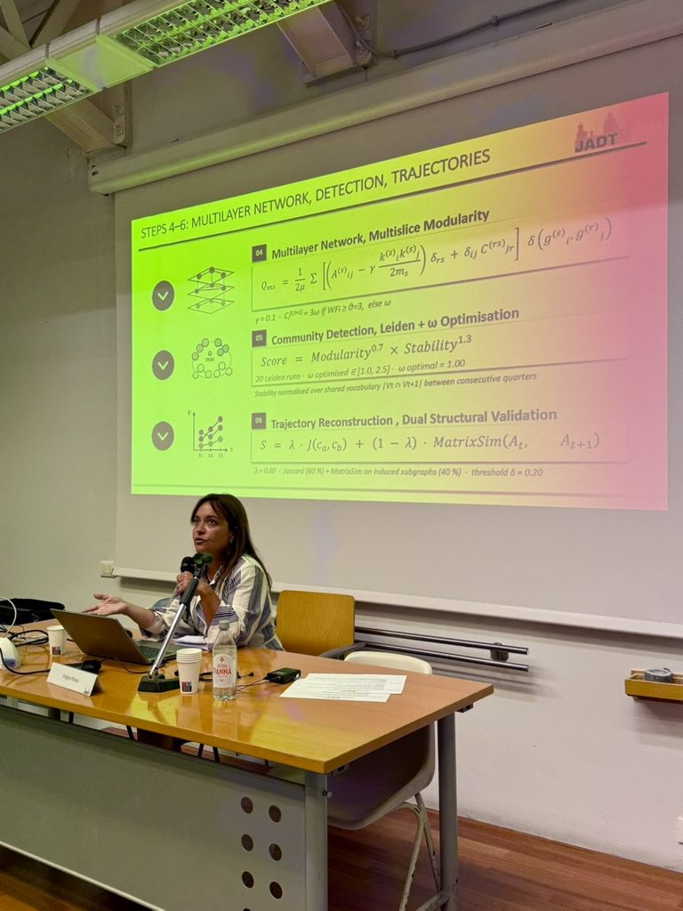
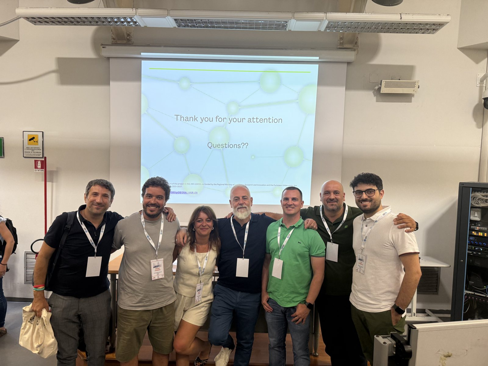
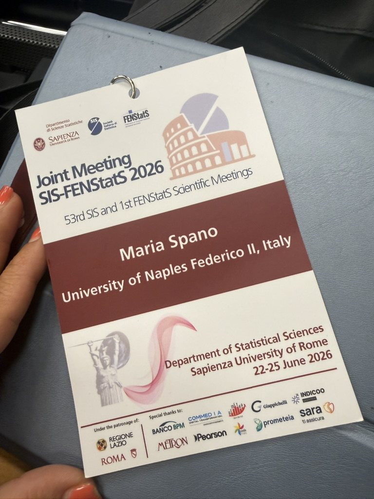
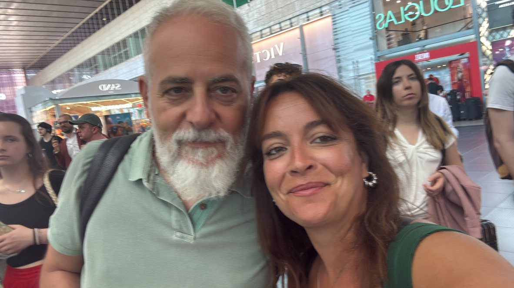
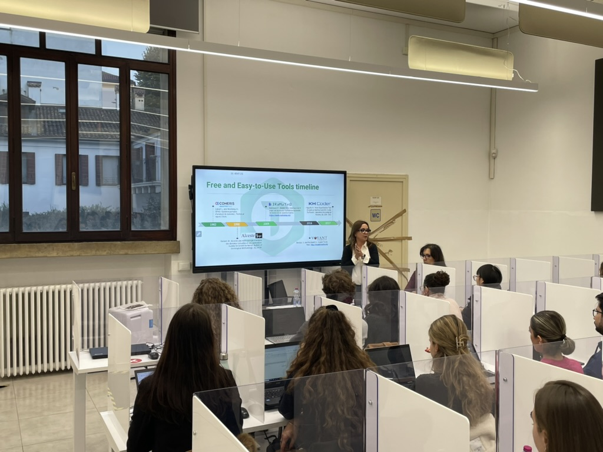
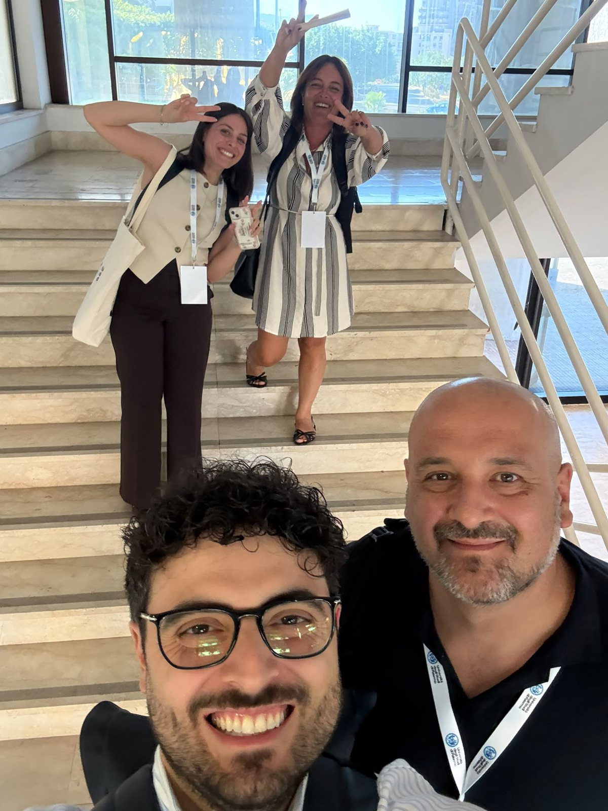

## Working Papers

- Aria, M., Cuccurullo, C., & Spano, M. (2026). *Multiplex coupling: Connecting the intellectual base and the topics of a research field*. arXiv:2610.21858. [arXiv](https://arxiv.org/abs/2610.21858)

- Alaimo, S. L., Aria, M., D'Aniello, L., & Spano, M. (2026). *Scientific knowledge and healthcare quality: A multidimensional assessment of Italian Academic Health Science Centres*. **Statistical Papers**. [under review]

## Journal Articles

- Aria, M., D'Aniello, L., Misuraca, M., & Spano, M. (2026). *Rethinking thematic evolution in science mapping: An integrated framework for longitudinal analysis*. **Journal of Informetrics**, 20(4), 101877. [DOI](https://doi.org/10.1016/j.joi.2026.101877)

- Misuraca, M., Spano, M., & D'Aniello, L. (2026). *Energy transition as the core of climate discourse: Mapping social representations in digital public debate*. **Energy Research & Social Science**, 140, 104945. [DOI](https://doi.org/10.1016/j.erss.2026.104945)

- Aria, M., Cuccurullo, C., D'Aniello, L., & Spano, M. (2026). *Biblioshiny and the SAAS Workflow: An integrated framework for transparent and reproducible science mapping. A demonstration through the replication of a study*. **Journal of Informetrics**, 20(3), 101837. [DOI](https://doi.org/10.1016/j.joi.2026.101837)

- Aria, M., D'Aniello, L., & Spano, M. (2026). *A multi-phase reference matching algorithm for bibliometric analysis: Design, implementation, and evaluation*. **Scientometrics**, 131(9), 6693–6728. [DOI](https://doi.org/10.1007/s11192-026-05763-2)

- Misuraca, M., Spano, M., & D'Aniello, L. (2026). *ThemeScope: A quantitative thematic analysis for depicting social representations in digital arenas*. **Journal of Information Science**, OnlineFirst, 1–18. [DOI](https://doi.org/10.1177/01655515261454276)

- Misuraca, M., D'Aniello, L., & Spano, M. (2026). *A computational pipeline for hierarchical evocation analysis of renewable energy in online climate discourse*. **Sustainability**, 18(14), 7295. [DOI](https://doi.org/10.3390/su18147295)

- Aria, M., Cuccurullo, C., D'Aniello, L., & Spano, M. (2026). *SciK-Health: An open-data dashboard for the multidimensional evaluation of Italian academic health science centers*. **Quality & Quantity**, 60(5), 16437–16466. [DOI](https://doi.org/10.1007/s11135-026-02827-6)

- Aria, M., Costanzo, D., Misuraca, M., & Spano, M. (2026). *Assessing tourism sustainability through Stochastic Multicriteria Acceptability Analysis: Insights from the Italian regional context*. **Management Decision**. [DOI](https://doi.org/10.1108/MD-09-2025-2815)

- Aria, M., Cuccurullo, C., D'Aniello, L., Misuraca, M., & Spano, M. (2026). *Sintetizzare la conoscenza: Un approccio integrato per l'estrazione di contenuti rilevanti nella letteratura scientifica*. **Tesi e Temi**, 1, Giapeto Editore, Napoli, 57–75.

- Aria, M., Spano, M., D'Aniello, L., Cuccurullo, C., & Misuraca, M. (2026). *TALL: Text Analysis for All – an interactive R-Shiny application for exploring, modeling, and visualizing textual data*. **SoftwareX**, 34, 102590. [DOI](https://doi.org/10.1016/j.softx.2026.102590)

- Cobo, M. J., De Mascellis, A. M., Misuraca, M., & Spano, M. (2025). *Automatic temporal framing detection for news analysis*. **Quality & Quantity**, 60(2), 5063–5085. [DOI](https://doi.org/10.1007/s11135-025-02492-1)

- Aria, M., Cuccurullo, C., D'Aniello, L., Misuraca, M., & Spano, M. (2024). *Comparative science mapping: a novel conceptual structure analysis with metadata*. **Scientometrics**, 129(11), 7055–7081. [DOI](https://doi.org/10.1007/s11192-024-05161-6)

- Misuraca, M., Spano, M., & Celardo, L. (2024). *E-wom and territorial analyses: the use of opinion mining in tourism*. **Turistica – Italian Journal of Tourism**, 33(1), 79–99.

- Celardo, L., Misuraca, M., & Spano, M. (2024). *Geo-referenced sentiment analysis for tourists' points of interest: the case of Matera European Capital of Culture*. **Rivista Italiana di Economia, Demografia e Statistica**, 78(2), 103–114.

- Del Gaudio, G., Di Taranto, E., & Spano, M. (2023). *Progress in Tourism Management: Insights for the tourism industry corporate governance*. **Corporate Ownership & Control**, 20(2), 182–195. [DOI](https://doi.org/10.22495/cocv20i2art15)

- Mele, C., Pels, J., Spano, M., & Di Bernardo, I. (2023). *Emergent understandings of the market*. **Italian Journal of Marketing**, 2023(1), 1–25.

- Blasius, J., Fabbris, L., Greenacre, M., Scepi, G., & Spano, M. (2023). *Special issue in memory of Simona Balbi*. **Italian Journal of Applied Statistics**, 35(3), 261–269.

- Mattera, R., Misuraca, M., Scepi, G., & Spano, M. (2023). *Mixed frequency composite indicators for measuring public sentiment in the EU*. **Quality & Quantity**, 57(3), 2357–2382.

- Pels, J., Mele, C., & Spano, M. (2023). *From market driving to market shaping: impact of a language shift*. **Journal of Business & Industrial Marketing**, 38(1), 155–169. [DOI](https://doi.org/10.1108/JBIM-10-2021-0503)

- D'Aniello, L., Spano, M., Cuccurullo, C., & Aria, M. (2022). *Academic Health Centers' configurations, scientific productivity, and impact: insights from the Italian setting*. **Health Policy**, 126(12), 1317–1323. [DOI](https://doi.org/10.1016/j.healthpol.2022.09.007)

- Aria, M., Cuccurullo, C., D'Aniello, L., Misuraca, M., & Spano, M. (2022). *Thematic Analysis as a new culturomic tool: the social media coverage on COVID-19 pandemic in Italy*. **Sustainability**, 14(6), 3643.

- Trinidad Segovia, J. E., Di Sciorio, F., Mattera, R., & Spano, M. (2022). *A Bibliometric Analysis on Agent‐Based Models in Finance: Identification of Community Clusters and Future Research Trends*. **Complexity**, 2022(1), 4741566. [DOI](https://dx.doi.org/10.1155/2022/4741566)

- Fedele, F., Aria, M., Esposito, V., Micillo, M., Cecere, G., Spano, M., & De Marco, G. (2022). *COVID-19 vaccine hesitancy: a survey in a population highly compliant to common vaccinations*. **Human Vaccines & Immunotherapeutics**, 17(13), 3348–3354. [DOI](https://dx.doi.org/10.1080/21645515.2021.1928460)

- Mattera, R., Misuraca, M., Scepi, G., & Spano, M. (2021). *A mixed-frequency approach for exchange rates predictions*. **Electronic Journal of Applied Statistical Analysis**, 14(1), 230–253.

- Misuraca, M., Scepi, G., & Spano, M. (2021). *Using Opinion Mining as an educational analytic: an integrated strategy for the analysis of students' feedback*. **Studies in Educational Evaluation**, 68, 100979.

- Aria, M., Misuraca, M., & Spano, M. (2020). *Mapping the evolution of social research and data science on 30 years of Social Indicators Research*. **Social Indicators Research**, 149(3), 803–831.

- Misuraca, M., Scepi, G., & Spano, M. (2020). *A network-based concept extraction for managing customer requests in a social media care context*. **International Journal of Information Management**, 51, 101956.

- Misuraca, M., Scepi, G., & Spano, M. (2020). *A bibliometric study on the evolution of Conjoint Analysis in 1998–2017*. **Italian Journal of Applied Statistics**, 32(1), 9–27.

- Matano, F., Caccavale, M., Esposito, G., Fortelli, A., Scepi, G., Spano, M., & Sacchi, M. (2020). *Integrated dataset of deformation measurements in fractured volcanic tuff and meteorological data*. **Earth System Science Data**, 12, 321–344. [DOI](https://doi.org/10.5194/essd-12-321-2020)

- Misuraca, M., Spano, M., & Balbi, S. (2019). *BMS: an improved Dunn index for Document Clustering validation*. **Communications in Statistics — Theory and Methods**, 48(20), 5036–5049.

- Balbi, S., Misuraca, M., & Spano, M. (2017). *A joint analysis of heterogeneous information on Italian listed firms*. **Italian Journal of Applied Statistics**, 29(2–3), 257–272.

- Dlova, N. C., Fabbrocini, G., Lauro, C., Spano, M., Tosti, A., & Hift, R. H. (2016). *Quality of life in South African Black women with alopecia: a pilot study*. **International Journal of Dermatology**, 55(8), 875–881. [DOI](https://doi.org/10.1111/ijd.13042)

- Ginesti, G., Macchioni, R., Sannino, G., & Spano, M. (2013). *The Impact of IASB's Guidelines for Preparing Management Commentary: Evidence from Italian Listed Firms*. **Journal of Modern Accounting and Auditing**, 9(3), 305–320.

## Books & Edited Volumes

- Cuccurullo, C., Aria, M., Spano, M., & D'Aniello, L. (2023). *Leading Change in Academic Health Science Centers*. Zaccaria srl, 1–124.

- Misuraca, M., Scepi, G., & Spano, M. (Eds.) (2022). *JADT 2022 – Proceedings of the 16th International Conference on Statistical Analysis of Textual Data*. VADISTAT Press / Edizioni Erranti, Napoli, 1–887.

## Book Chapters

- Cozzucoli, L. A., Misuraca, M., & Spano, M. (2026). *Evaluating the impact of government orientation on the adoption of AI in business: A causal inference study*. In F. Greco, A. Fronzetti Colladon, P. A. Gloor (Eds.), *Artificial Intelligence and Networks for a Sustainable Future: Connecting Species*, Springer, Cham, pp. 369–377. [DOI](https://doi.org/10.1007/978-3-032-13458-5_20)

- De Mascellis, A. M., Misuraca, M., Scepi, G., & Spano, M. (2026). *An automatic framing approach to analyse newspaper and press language*. In E. Amaturo, B. Aragona, C. Crocetta, M. G. Grassia, C. N. Lauro, M. Marino (Eds.), *Data Science and Social Research III – Epistemology, Methods, Technology, Applications, and Relation to Artificial Intelligence*, Springer, Cham, pp. 1–12.

- Spano, M., Misuraca, M., & Celardo, L. (2025). *From Vectors to Networks: Comparing Conventional and Graph-Based Approaches to Unsupervised Text Categorisation*. In A. D'Ambrosio et al. (Eds.), *Supervised and Unsupervised Statistical Data Analysis*, Springer, Cham, pp. 304–315.

- Misuraca, M., Scepi, G., & Spano, M. (2023). *Network-based dimensionality reduction for textual datasets*. In E. Brentari, M. Chiodi, E.-J. C. Wit (Eds.), *Models for Data Analysis*, Springer, Cham, pp. 175–190.

- Misuraca, M., & Spano, M. (2020). *Unsupervised analytic strategies to explore large document collections*. In D. F. Iezzi, D. Mayaffre, M. Misuraca (Eds.), *Text Analytics. Advances and Challenges*, Springer, Heidelberg, pp. 17–28.

- Stawinoga, A., Spano, M., & Triunfo, N. (2016). *Extracting meta-information by using Network Analysis tools*. In G. Alleva, A. Giommi (Eds.), *Studies in Theoretical and Applied Statistics*, Springer, pp. 101–109. [DOI](https://doi.org/10.1007/978-3-319-27274-0_9)

## Conference Proceedings

- Misuraca, M., Spano, M., & D'Aniello, L. (2026). *Constructing climate change discourse in the digital public sphere: A computational analysis of social representations*. In A. Plaia, M. Sciandra, A. Albano (Eds.), *JADT2026 – 18th International Conference on Statistical Analysis of Textual Data*, Vol. I, Palermo University Press, pp. 253–262.

- Aria, M., Cobo, M. J., D'Aniello, L., Misuraca, M., & Spano, M. (2026). *Temporal dynamics of AI news frames: A multilayer network approach*. In A. Plaia, M. Sciandra, A. Albano (Eds.), *JADT2026 – 18th International Conference on Statistical Analysis of Textual Data*, Vol. I, Palermo University Press, pp. 263–272.

- Aria, M., Cobo, M. J., D'Aniello, L., Misuraca, M., & Spano, M. (2026). *A multilayer network approach for longitudinal frame detection in newspaper and press language*. In F. Martella, S. Arima, M. F. Marino, C. Mollica (Eds.), *Statistical Science: From Theory to Applied Research II – SIS-FENStatS 2026*, Springer, Cham, pp. 101–107. [DOI](https://doi.org/10.1007/978-3-032-30877-1_17)

- Aria, M., Cuccurullo, C., D'Aniello, L., Spano, M., & Alabiso, C. (2025). *From data collection to knowledge in health: Turning scientific production into practical decision-making tools*. In G. Boccuzzo et al. (Eds.), *IES 2025 – Statistics and Data Science for Evaluation and Quality*, Cleup, Padova. ISBN: 978-88-5495-849-4.

- Gnasso, A., Sacco, D., Celardo, L., Smecca, M. A., Alabiso, C., & Spano, M. (2025). *Research excellence and patient perception: investigating the impact of AHSCs' scientific output*. In G. Boccuzzo et al. (Eds.), *IES 2025*, Cleup, Padova. ISBN: 978-88-5495-849-4.

- Aria, M., Cuccurullo, C., D'Aniello, L., & Spano, M. (2025). *Keyword-enhanced summarization from scientific literature through an integrated approach*. In L. S. Alaimo, F. Crescenzi, L. Fabbris, F. Maggino, M. Vichi (Eds.), *Measuring and Interpreting World Changes with Statistics, Data Science and AI (ASA 2024)*, Firenze University Press, pp. 37–43. [DOI](https://doi.org/10.26398/asaproc.0076)

- Belfiore, A., Spano, M., Cuccurullo, C., & Giordano, W. (2024). *Beyond Text: Unveiling Corporate Communication Strategies Through Textual Analysis of CEO Letters*. In A. Dister, D. Longrée (Eds.), *JADT24*, Presses Universitaires De Louvain, Vol. 1, pp. 69–78. ISBN: 978-2-39061-471-5.

- Aria, M., Cuccurullo, C., D'Aniello, L., Misuraca, M., & Spano, M. (2024). *Breaking barriers with TALL: a text analysis Shiny app for all*. In A. Dister, D. Longrée (Eds.), *JADT24*, Presses Universitaires De Louvain, Vol. 1, pp. 39–48. ISBN: 978-2-39061-471-5.

- Celardo, L., Misuraca, M., & Spano, M. (2024). *See Naples, then dye: Spatial Categorisation of Tourist Attractions with Reviews' Sentiment Scores*. In A. Dister, D. Longrée (Eds.), *JADT24*, Presses Universitaires De Louvain, Vol. 1, pp. 189–198. ISBN: 978-2-39061-471-5.

- D'Aniello, L., Aria, M., Cuccurullo, C., Misuraca, M., & Spano, M. (2024). *Extracting knowledge from scientific literature with an integrated text summarization approach*. In A. Dister, D. Longrée (Eds.), *JADT24*, Presses Universitaires De Louvain, Vol. 1, pp. 239–248. ISBN: 978-2-39061-471-5.

- Costanzo, G. D., Dattilo, B., Di Torrice, M., Misuraca, M., & Spano, M. (2025). *Measuring sustainability in tourism via a multi-criteria decision making approach*. In A. Pollice, P. Mariani (Eds.), *Methodological and Applied Statistics and Demography III (SIS 2024)*, Springer Nature, pp. 513–518. [DOI](https://doi.org/10.1007/978-3-031-64431-3_85)

- Aria, M., Cuccurullo, C., D'Aniello, L., Misuraca, M., & Spano, M. (2025). *TALL: A new Shiny app for Text Analysis*. In A. Pollice, P. Mariani (Eds.), *Methodological and Applied Statistics and Demography III (SIS 2024)*, Springer Nature, pp. 64–70. [DOI](https://doi.org/10.1007/978-3-031-64431-3_11)

- Celardo, L., Misuraca, M., & Spano, M. (2024). *Spatial sentiment analysis of tourist points of interest*. In M. Antonicelli et al. (Eds.), *Quality of Life: Challenges and Opportunities in the Crossroads of the Mediterranean (AIQUAV 2023)*, Università di Bari Aldo Moro, pp. 82–92.

- Aria, M., Cuccurullo, C., D'Aniello, L., Misuraca, M., & Spano, M. (2023). *TAll: a new Shiny app of Text Analysis for All*. In F. Boschetti et al. (Eds.), *CLiC-it 2023*, CEUR Workshop Proceedings, Vol. 3596, pp. 1–4.

- Celardo, L., Misuraca, M., & Spano, M. (2023). *Georeferencing sentiment scores to map and explore tourist points of interest*. In R. Martínez-Torres, S. Toral (Eds.), *CARMA 2023*, Editorial UPV, pp. 115–122.

- Aria, M., Cuccurullo, C., D'Aniello, L., Misuraca, M., & Spano, M. (2022). *Text Summarization of a scientific document: a comparison of extractive unsupervised methods*. In M. Misuraca, G. Scepi, M. Spano (Eds.), *JADT2022*, VADISTAT Press, Napoli, pp. 67–73.

- Cobo, M. J., & Spano, M. (2022). *An automatic approach for bibliographical co-words networks labelling*. In *SIS 2022*, Pearson, pp. 773–779.

- Basile, V., Misuraca, M., & Spano, M. (2022). *Thematic analysis on online education issues during COVID-19*. In *SIS 2022*, Pearson, pp. 437–445.

- Belfiore, A., Spano, M., Mandenaki, K., & Giordano, W. (2022). *Exploring companies' communication strategies in the Covid-19 era*. In M. Misuraca, G. Scepi, M. Spano (Eds.), *JADT2022*, VADISTAT Press, Napoli.

- Ferracci, M., Scepi, G., Spano, M., & Misuraca, M. (2022). *Nodi discorsivi e processi di progettazione condivisa: Milano e Torino*. In M. Misuraca, G. Scepi, M. Spano (Eds.), *JADT2022*, VADISTAT Press, Napoli, pp. 400–407.

- Mattera, R., Misuraca, M., Scepi, G., & Spano, M. (2022). *Clustering of financial time series: a bibliometric analysis*. In M. Misuraca, G. Scepi, M. Spano (Eds.), *JADT2022*, VADISTAT Press, Napoli, pp. 584–590.

- Aria, M., Cuccurullo, C., D'Aniello, L., & Spano, M. (2022). *Thematic evolution of Academic Medical Centers' research: a focus on Italian public owned AOUs in metropolitan areas*. In *IES 2022*, Vol. 1, pp. 67–72. ISBN: 978-88-94593-35-8.

- Cuccurullo, C., D'Aniello, L., Aria, M., & Spano, M. (2021). *Measuring the impact of healthcare indicators on academic medical centers' scientific production*. In *ASA 2021*, Firenze University Press, Vol. 132, pp. 160–165.

- Cuccurullo, C., D'Aniello, L., & Spano, M. (2021). *Thematic atlas of Italian oncological research: the analysis of public IRCCS*. In *ASA 2021*, Firenze University Press, Vol. 127, pp. 109–114. [DOI](https://doi.org/10.36253/978-88-5518-304-8.22)

- Misuraca, M., Scepi, G., & Spano, M. (2021). *A comparative study on community detection and clustering algorithms for text categorisation*. In *JADT2020* [online].

- Carannante, M., Mattera, R., Scepi, G., Misuraca, M., & Spano, M. (2020). *Nowcasting GDP using mixed-frequency based composite confidence indicators*. In *SIS 2020*, Pearson, pp. 981–986.

- Forciniti, A., Misuraca, M., Scepi, G., & Spano, M. (2019). *Generalized Procrustes Analysis for Multilingual Studies*. In *SIS 2019*, Pearson, pp. 879–884.

- Scepi, G., Misuraca, M., Spano, M., Carannante, M., & Mattera, R. (2019). *Temporal sentiment analysis with distributed lag models*. In *SIS 2019*, Pearson, pp. 149–156.

- Misuraca, M., Scepi, G., & Spano, M. (2018). *A network approach to dimensionality reduction in Text Mining*. In *SIS 2018*, Pearson, pp. 344–351.

- Balbi, S., Misuraca, M., & Spano, M. (2018). *A two-step strategy for improving categorisation of short texts*. In *JADT2018*, UniversItalia, Roma, Vol. 1, pp. 60–67.

- Balbi, S., Misuraca, M., & Spano, M. (2016). *A cosine-based validation index for Document Clustering*. In *JADT2016*, Presses Fac Imprimeur, Nice, Vol. 1, pp. 65–74.

- Misuraca, M., & Spano, M. (2013). *Comparing text clustering algorithms from a multivariate perspective*. In *CLADAG 2013*, CLEUP, Padova, pp. 331–334.

- Stawinoga, A., Spano, M., & Triunfo, N. (2012). *Extracting meta-information by using Network Analysis tools*. In *46th SIS Meeting*, Roma (invited session). ISBN: 978-88-6129-882-8.

- Ginesti, G., Maffei, M., Spano, M., & Triunfo, N. (2012). *A textual processing approach for analysing the narrative disclosures in corporate reports*. *AMIS 2012*. ISSN: 2247-6245.

- Spano, M., & Triunfo, N. (2012). *La relazione sulla gestione delle società italiane quotate sul mercato regolamentato*. *JADT 2012*. ISBN: 978-2-9601246-0-6.

## Technical Reports & Software

- Misuraca, M., Forciniti, A., Scepi, G., & Spano, M. (2020). *Sentiment Analysis for Education with R: packages, methods and practical applications*. arXiv:2005.12840. [arXiv](https://arxiv.org/abs/2005.12840)

- Hudec, M., Balbi, S., Juriova, J., Spano, M., Stawinoga, A., & Triunfo, N. (2012). *Report on principles of fuzzy methodology and tools developed for use in data collection (Soft computing and text mining tools for Official Statistics)*. BLUE-ETS Project, Deliverable 5.1.

- D'Aniello, L., Misuraca, M., & Spano, M. (2026). **themescopeR: Social Representation Analysis via Semantic Network Mapping** — R package. CRAN. [DOI](https://doi.org/10.32614/CRAN.package.themescopeR)

- Aria, M., Cuccurullo, C., D'Aniello, L., Misuraca, M., & Spano, M. (2023). **TALL: Text Analysis for All** — R/Shiny application. CRAN. [cran.r-project.org/package=tall](https://cran.r-project.org/web/packages/tall/index.html)

## From the Conferences

I regularly present at national and international conferences on **text mining**, **data science** and **statistical analysis of textual data**. Since 2024 I have been a permanent member of the Scientific Committee of JADT.

### JADT 2026 · Palermo, 8–10 July

<a href="images/2026/jadt26-talk1.jpg" data-lightbox="jadt26" data-title="JADT 2026 · presenting our work">JADT 2026 · presenting our work</a>
<a href="images/2026/jadt26-group.jpg" data-lightbox="jadt26" data-title="JADT 2026 · with co-authors and colleagues">JADT 2026 · with co-authors and colleagues</a>
<a href="images/2026/jadt26-talk2.jpg" data-lightbox="jadt26" data-title="JADT 2026 · discussion">JADT 2026 · discussion</a>
<a href="images/2026/jadt26-palermo.jpg" data-lightbox="jadt26" data-title="JADT 2026 · Palermo">JADT 2026 · Palermo</a>
<a href="images/2026/jadt26-dinner.jpg" data-lightbox="jadt26" data-title="JADT 2026 · social dinner">JADT 2026 · social dinner</a>

### SIS-FENStatS 2026 · Rome, 22–25 June

<a href="images/2026/sis26-talk.jpg" data-lightbox="sis26" data-title="SIS-FENStatS 2026 · presenting our work">SIS-FENStatS 2026 · presenting our work</a>
<a href="images/2026/sis26-badge.jpg" data-lightbox="sis26" data-title="SIS-FENStatS 2026 · Sapienza, Rome">SIS-FENStatS 2026 · Sapienza, Rome</a>
<a href="images/2026/sis26-colleagues.jpg" data-lightbox="sis26" data-title="SIS-FENStatS 2026">SIS-FENStatS 2026</a>
<a href="images/2026/sis26-rome.jpg" data-lightbox="sis26" data-title="SIS-FENStatS 2026 · Rome">SIS-FENStatS 2026 · Rome</a>

### Earlier conferences

<a href="images/publ.jpeg" data-lightbox="conf" data-title="JADT 2024 · Université Saint-Louis Bruxelles">JADT 2024 · Université Saint-Louis Bruxelles</a>
<a href="images/pub4.jpeg" data-lightbox="conf" data-title="DSSR 2024 · presenting TALL">DSSR 2024 · presenting TALL</a>
<a href="images/pub2.jpeg" data-lightbox="conf" data-title="TALL session">TALL session</a>
<a href="images/pub3.jpg" data-lightbox="conf" data-title="Teaching at University of Padova">Teaching at University of Padova</a>
<a href="images/2026/conf-stairs.jpg" data-lightbox="conf" data-title="With colleagues">With colleagues</a>

