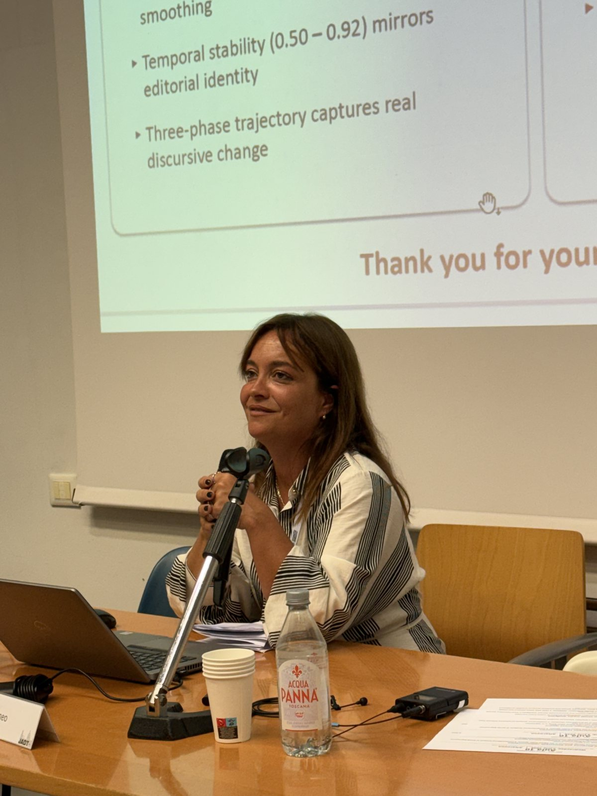
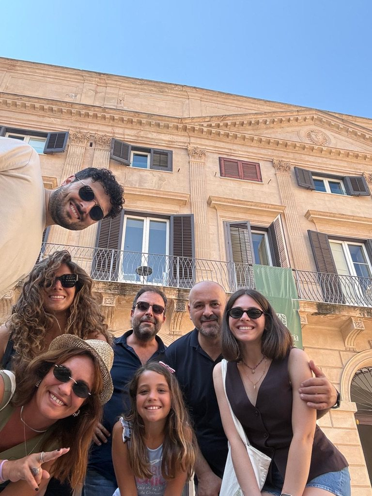
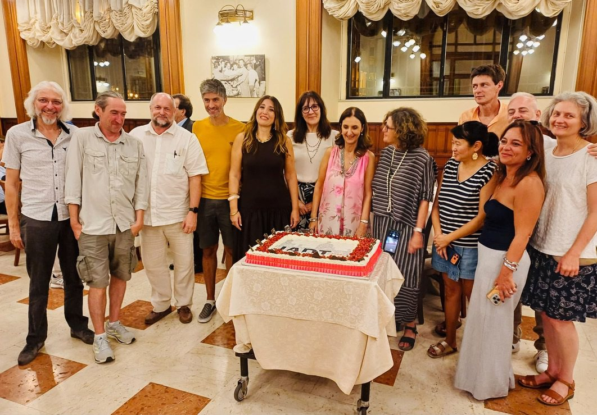
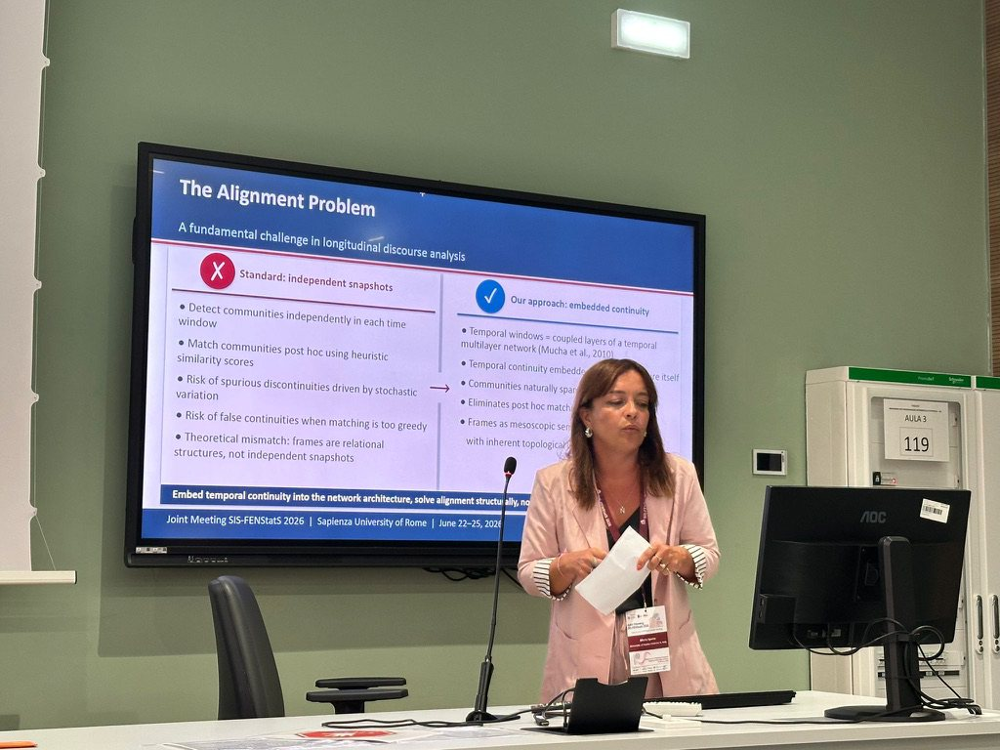
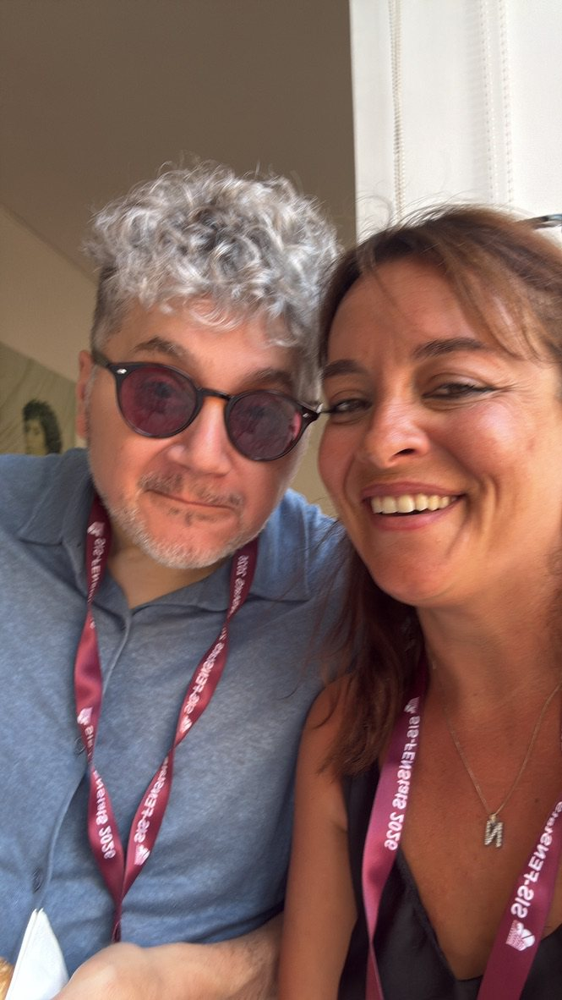
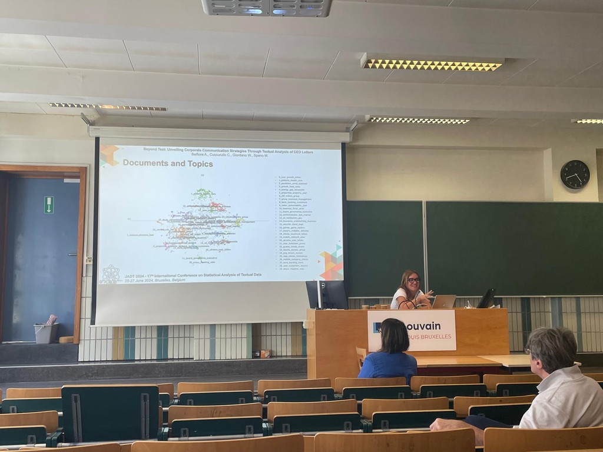
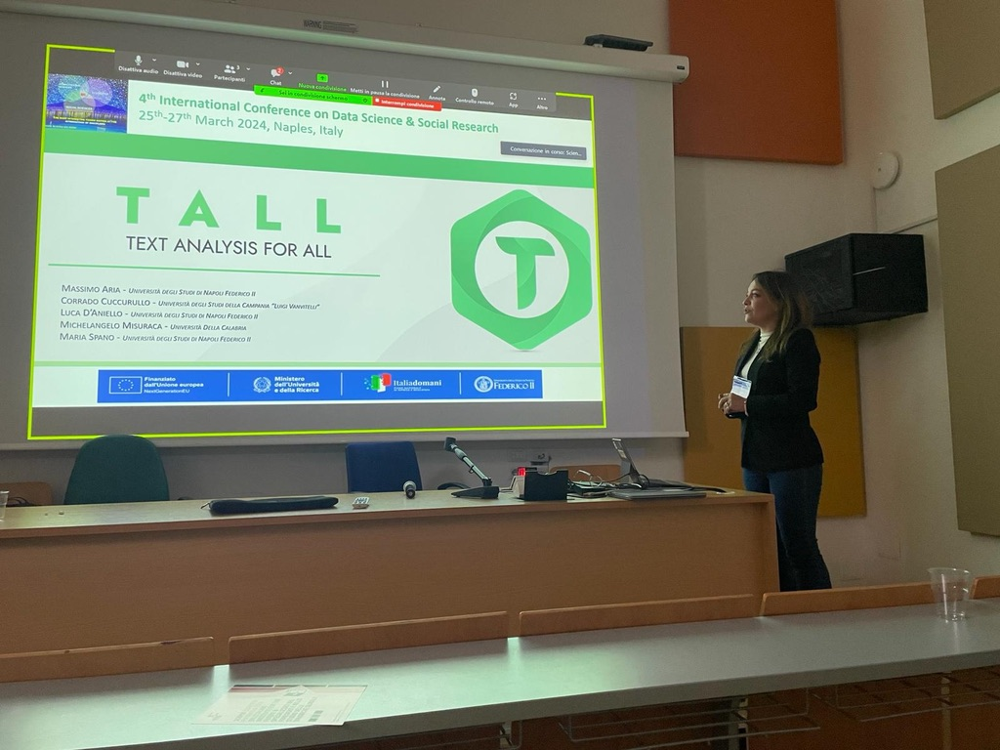
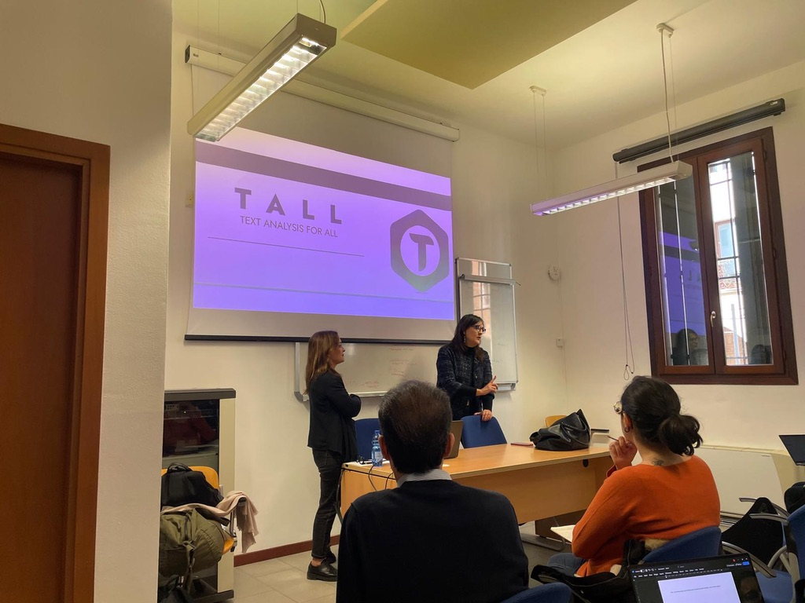



## From the Conferences

I regularly present at national and international conferences on **text mining**, **data science** and **statistical analysis of textual data**. Since 2024 I have been a permanent member of the Scientific Committee of JADT.

### JADT 2026 · Palermo, 8–10 July

<a href="images/2026/jadt26-talk1.jpg" data-lightbox="jadt26" data-title="JADT 2026 · presenting our work">JADT 2026 · presenting our work</a>
<a href="images/2026/jadt26-group.jpg" data-lightbox="jadt26" data-title="JADT 2026 · with co-authors and colleagues">JADT 2026 · with co-authors and colleagues</a>
<a href="images/2026/jadt26-talk2.jpg" data-lightbox="jadt26" data-title="JADT 2026 · discussion">JADT 2026 · discussion</a>
<a href="images/2026/jadt26-palermo.jpg" data-lightbox="jadt26" data-title="JADT 2026 · Palermo">JADT 2026 · Palermo</a>
<a href="images/2026/jadt26-dinner.jpg" data-lightbox="jadt26" data-title="JADT 2026 · social dinner">JADT 2026 · social dinner</a>

### SIS-FENStatS 2026 · Rome, 22–25 June

<a href="images/2026/sis26-talk.jpg" data-lightbox="sis26" data-title="SIS-FENStatS 2026 · presenting our work">SIS-FENStatS 2026 · presenting our work</a>
<a href="images/2026/sis26-badge.jpg" data-lightbox="sis26" data-title="SIS-FENStatS 2026 · Sapienza, Rome">SIS-FENStatS 2026 · Sapienza, Rome</a>
<a href="images/2026/sis26-colleagues.jpg" data-lightbox="sis26" data-title="SIS-FENStatS 2026">SIS-FENStatS 2026</a>
<a href="images/2026/sis26-rome.jpg" data-lightbox="sis26" data-title="SIS-FENStatS 2026 · Rome">SIS-FENStatS 2026 · Rome</a>

### Earlier conferences

<a href="images/publ.jpeg" data-lightbox="conf" data-title="JADT 2024 · Université Saint-Louis Bruxelles">JADT 2024 · Université Saint-Louis Bruxelles</a>
<a href="images/pub4.jpeg" data-lightbox="conf" data-title="DSSR 2024 · presenting TALL">DSSR 2024 · presenting TALL</a>
<a href="images/pub2.jpeg" data-lightbox="conf" data-title="TALL session">TALL session</a>
<a href="images/pub3.jpg" data-lightbox="conf" data-title="Teaching at University of Padova">Teaching at University of Padova</a>
<a href="images/2026/conf-stairs.jpg" data-lightbox="conf" data-title="With colleagues">With colleagues</a>

