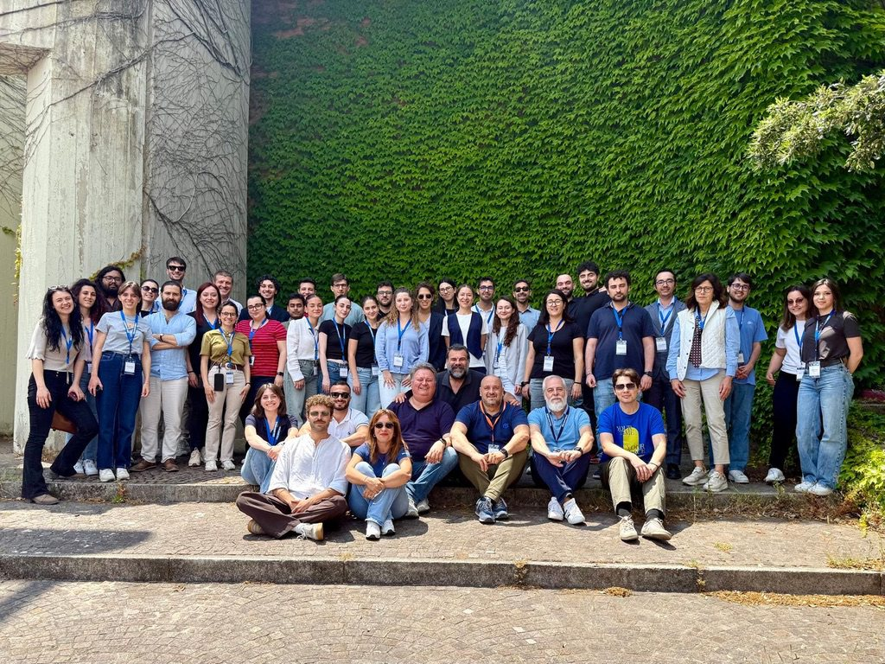
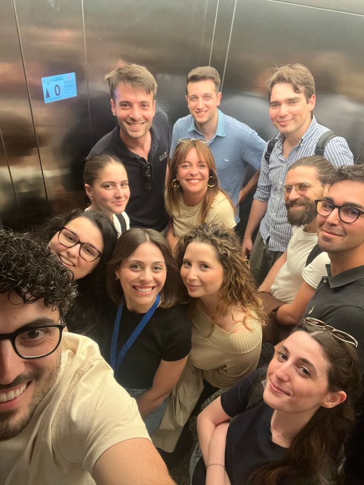
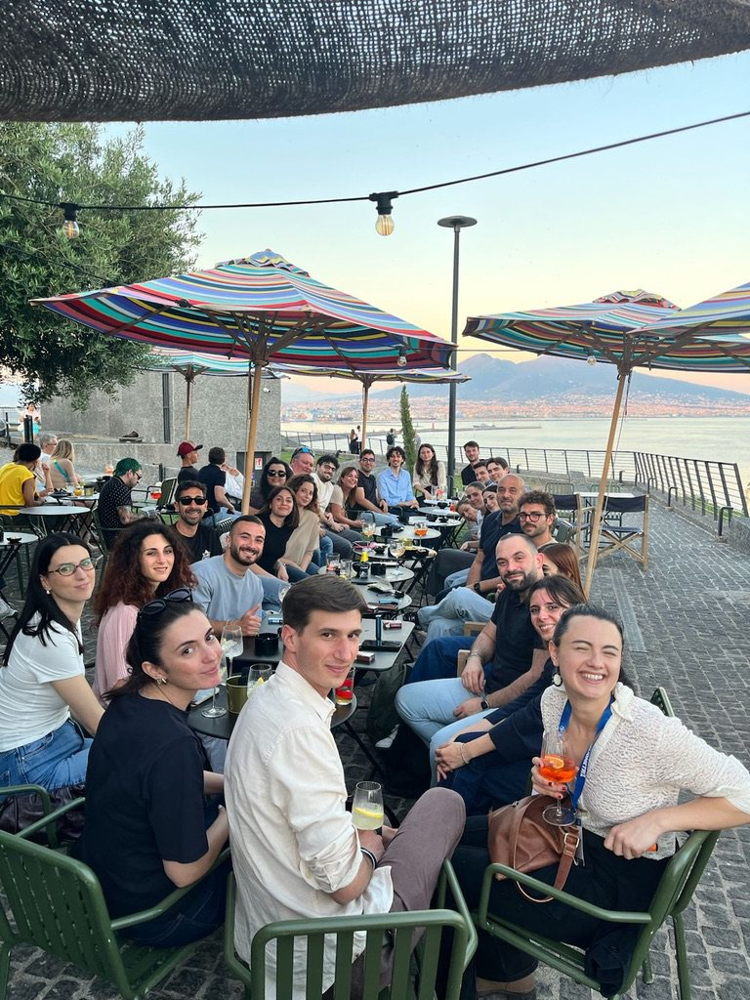
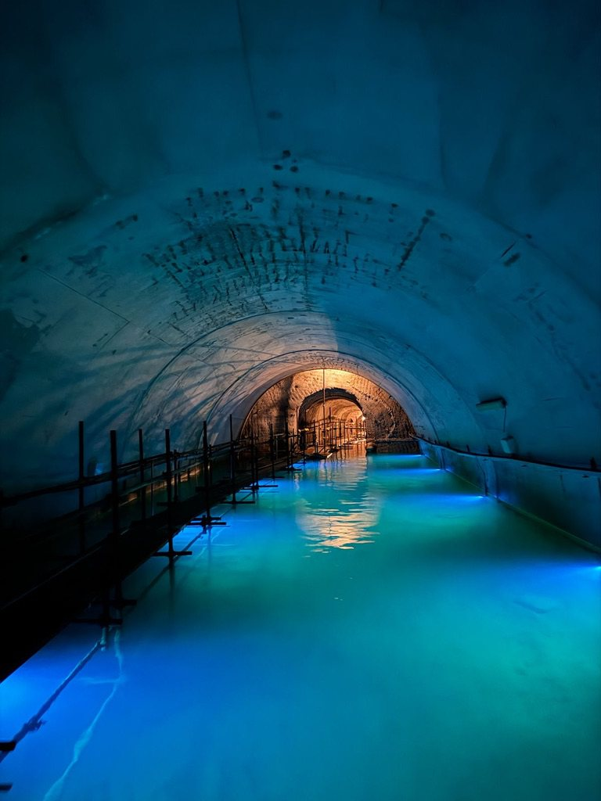
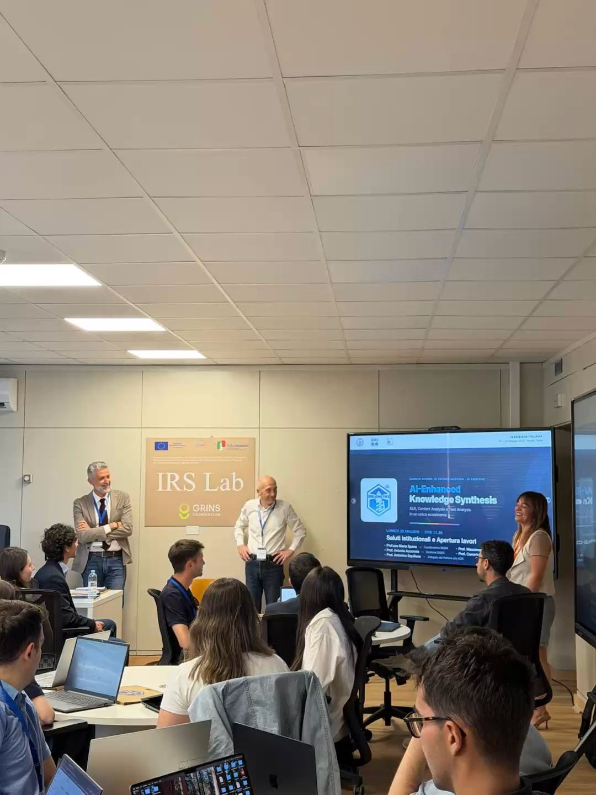

## University Courses

- [Since 2025]{.t-when} Lecturer — *"Text Analysis and Social Media Mining"*, Master's Degree in Economics and Commerce, Department of Economics and Statistics, University of Naples Federico II.
- [Since 2022]{.t-when} Lecturer — Laboratory *"Text Mining and Literature Review"*, Master's Degree in Economics and Commerce, Department of Economics and Statistics, University of Naples Federico II.
- [2020–2022]{.t-when} Lecturer — *"Computer Science"* (Undergraduate programs in Economics and Commerce, and Economics of Financial Enterprises), Department of Economics and Statistics, University of Naples Federico II.
- [Since 2020]{.t-when} Lecturer — *"Data Analysis and Revenue Management"* (integrated course, Bachelor's Degree in Tourism Management), Department of Economics and Statistics, University of Naples Federico II.
- [Since 2015]{.t-when} Teaching assistant — *"Statistics and Time Series Analysis"* (Prof. Germana Scepi), Undergraduate programs in Economics and Commerce and Economics of Financial Enterprises, University of Naples Federico II.
- [2017–2021]{.t-when} Teaching assistant — *"Statistical Methods for Data Mining"* (Prof. Cristina Davino), Master's Degree in Economics and Commerce, University of Naples Federico II (including 8 hours of lectures and a lab on quantitative text analysis).
- [2015–2016]{.t-when} Adjunct lecturer — integrative teaching activities in *"Statistics"*, Department of Economics and Statistics, University of Naples Federico II (also 2014–2015).
- [2014–2015]{.t-when} Adjunct lecturer — *"Statistics"*, Department of Political Science, Communication and International Relations, University of Macerata.
- [2010–2016]{.t-when} During my PhD, I contributed to teaching activities in:
  - *"Business Statistics"* (Prof. Simona Balbi): exams;
  - *"Multivariate Analysis"* (Prof. Carlo Lauro): exams, student tutoring (2010/2011); lectures on Linear Algebra (2011/2012–2012/2013);
  - *"Data Mining"* (Prof. Simona Balbi): exams and thesis tutoring;
  - *"Basic Statistics"* (Prof. Germana Scepi): exams;
  - *"Market Analysis Statistics"* (Prof. Simona Balbi): lab activities and exams (2011/2012–2012/2013);
  - *"Linear Models"* (Prof. Carlo Lauro): exams and tutoring (2010/2011–2011/2012);
  - *"Statistical Methods for Data Mining"* (Prof. Simona Balbi): exams and tutoring (2010/2011–2015/2016).

## Master & PhD Courses, Seminars

- [2026/27]{.t-when} Lecturer — *"Data-Driven Destination Management"* module (21 hours, 3 ECTS), 1st-level University Master in *"Digital Management of Smart Tourism Systems"*, Department of Economics and Statistics, University of Naples Federico II.
- [Since 2020]{.t-when} Lecturer — Text Mining module, 2nd-level University Master in *"Data Science"* (2020–2023), renamed *"Artificial Intelligence & Data Science"* in 2024, Department of Economics, Statistics and Finance, University of Calabria.
- [04/03/2024]{.t-when} Seminar — *"Textual Data Analysis. Theoretical and Applied Aspects"* (8 hours), PhD in "Social and Statistical Sciences" (Univ. Naples Federico II) and PhD in "Entrepreneurship and Innovation" (Univ. Campania L. Vanvitelli & Univ. Naples Parthenope).
- [04/07/2023]{.t-when} Seminar — *"From Words to Numbers. Statistical Methods for Textual Data Analysis"*, same PhD programs.
- [21–28/03 and 04/04/2023]{.t-when} Seminar series — *"Introduction to Computational Linguistics: statistical methods and software for corpus analysis"*, PhD in "Literary, Linguistic and Comparative Studies", University of Naples L'Orientale.
- [21/10/2022 and 25–26/06/2020]{.t-when} Seminar — *"Textual Data Analysis. Theoretical and Applied Aspects"*, PhD in "Entrepreneurship and Innovation", Univ. Campania L. Vanvitelli & Naples Parthenope.
- [10/05/2019]{.t-when} Seminar — *"Textual Data Analysis. Theoretical and Applied Aspects"*, same PhD program.
- [29–31/01/2019]{.t-when} Lecturer — *"Research Synthesis and Bibliometrics Lab"*, PhD in "Entrepreneurship and Innovation", University of Campania Luigi Vanvitelli.
- [20/11/2014]{.t-when} Seminar — *"PLS-Path Modeling: Theory and Applications"*, PhD in Agricultural and Food Sciences, University of Naples Federico II.

## Tutorials, Workshops and Summer Schools

- [May 2026]{.t-when} **Coordinator and Lecturer** — IV edition of the Summer School *"Science Mapping – Systematic Literature Review with Bibliometrix and Biblioshiny"*, K-Synth and Dept. of Economics and Statistics, University of Naples Federico II. Naples, 25–29 May 2026.
- [December 2025]{.t-when} Lecturer — Workshop *"Mapping the Frontiers of Knowledge – New Directions in Bibliometric Research and Open Science Analytics"*, University of Salerno, 17 December 2025.
- [September 2025]{.t-when} Lecturer — International workshop *"Literature Synthesis and Bibliometric Analysis: A Hands-On Workshop"* (with Massimo Aria, Tiziana Spano, Corrado Cuccurullo), RC33 – International Sociological Association, 22 September 2025.
- [June 2025]{.t-when} **Coordinator and Lecturer** — 1st International Edition, Summer School in *"Science Mapping"*, K-Synth and Dept. of Economics and Statistics, University of Naples Federico II. Naples, 9–13 June 2025.
- [2023–2025]{.t-when} **Coordinator and Lecturer** — Summer School *"Science Mapping – Systematic Literature Review with Bibliometrix and Biblioshiny"* (I, II and III editions), K-Synth and Dept. of Economics and Statistics, University of Naples Federico II. Naples, 26–30 June 2023 / 27–31 May 2024 / 26–30 May 2025.

### Summer School in Science Mapping · 2026

<a href="images/2026/ss26-group.jpg" data-lightbox="ss26" data-title="Summer School 2026 · class photo">Summer School 2026 · class photo</a>
<a href="images/2026/ss26-selfie.jpg" data-lightbox="ss26" data-title="Summer School 2026">Summer School 2026</a>
<a href="images/2026/ss26-dinner.jpg" data-lightbox="ss26" data-title="Summer School 2026 · social dinner">Summer School 2026 · social dinner</a>
<a href="images/2026/ss26-naples-underground.jpg" data-lightbox="ss26" data-title="Summer School 2026 · Naples">Summer School 2026 · Naples</a>
<a href="images/2026/irs-lab-workshop.jpg" data-lightbox="ss26" data-title="Workshop at IRS Lab">Workshop at IRS Lab</a>

